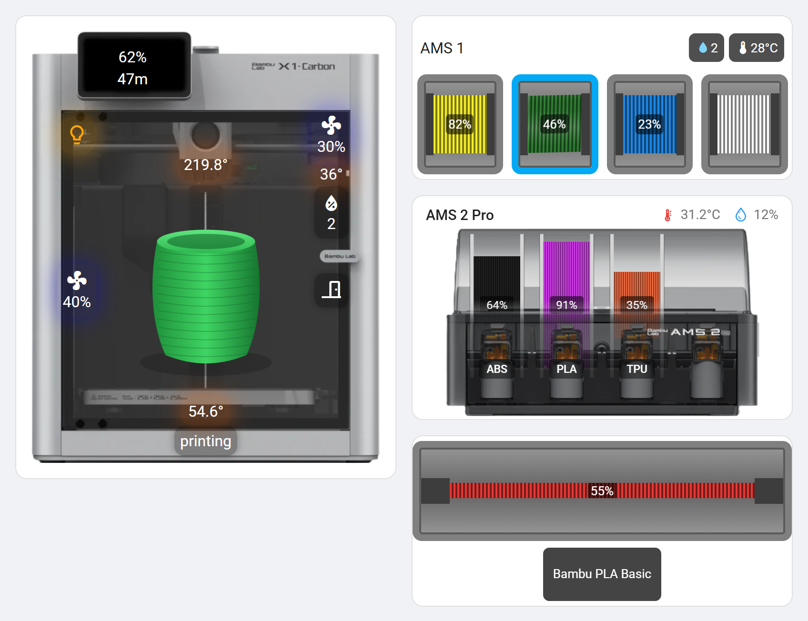
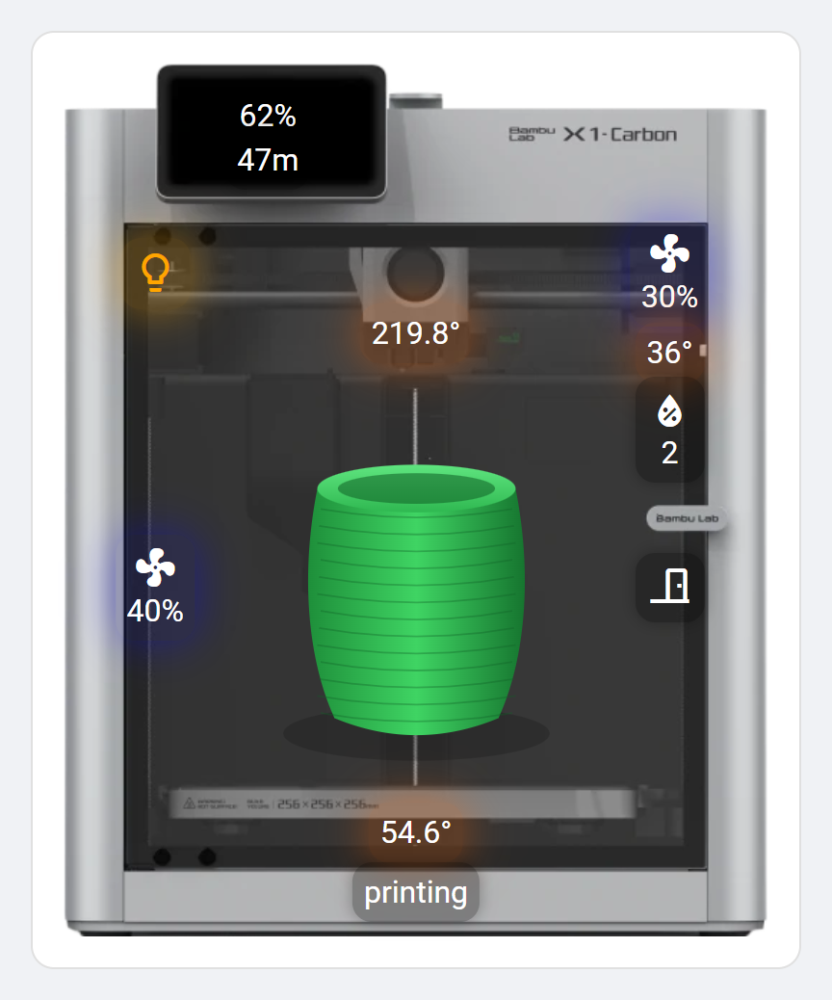
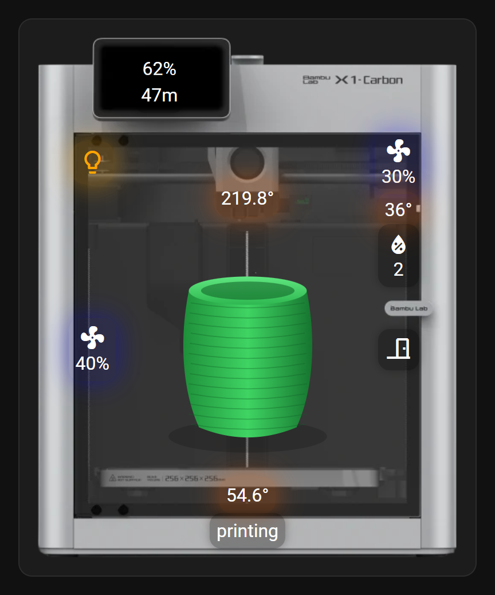
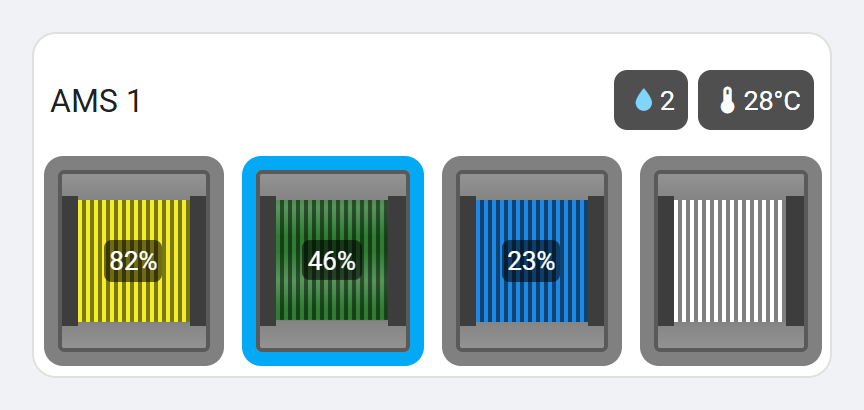
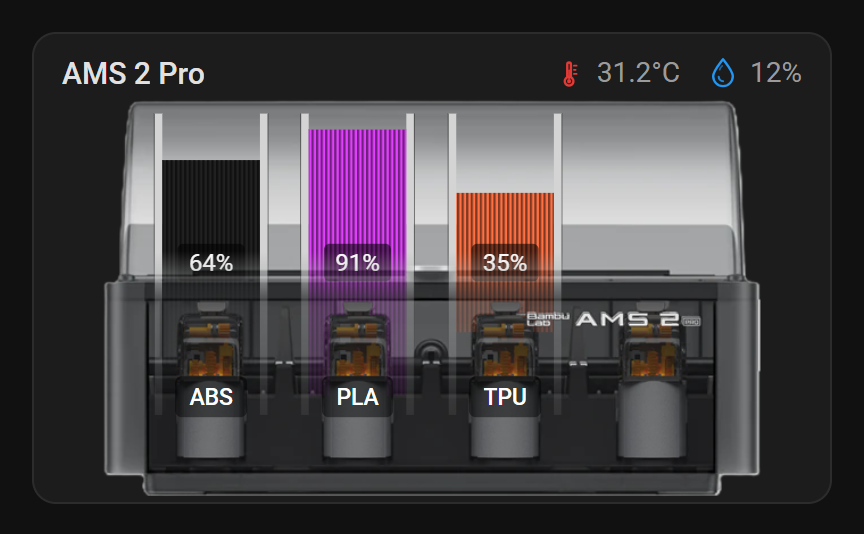
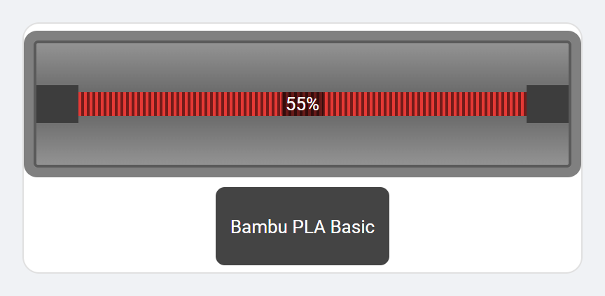
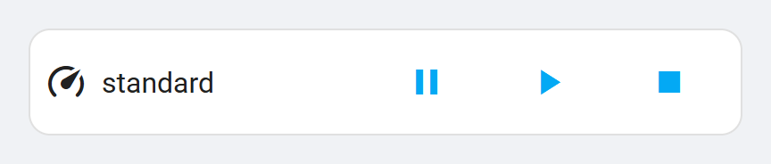
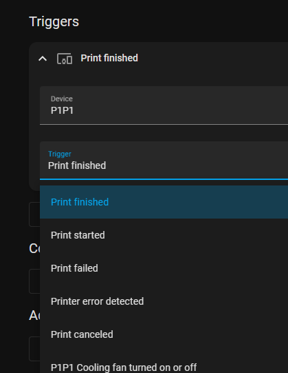
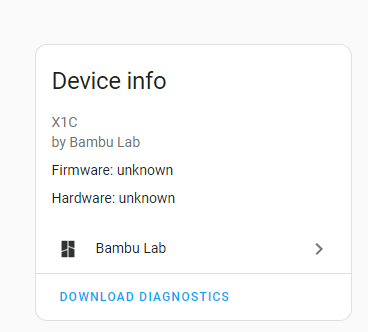

# ha-bambulab

[](https://github.com/hacs/integration)


[](https://discord.gg/rsUHAW3DKz)
[](LICENSE)

 [](https://github.com/greghesp/ha-bambulab/releases)
 [](https://github.com/greghesp/ha-bambulab/releases)

> A Home Assistant integration for **Bambu Lab** 3D printers.
> Live print status, temperatures, fans, AMS and external spool filament,
> chamber camera, print controls, HMS errors, device triggers, MakerWorld
> stats and a set of built-in dashboard cards. Connects through Bambu Cloud
> or directly to the printer on your LAN.



<sub>The bundled dashboard cards, rendered with sample data. Your cards show
your printer's real values and print preview.</sub>

Full documentation lives at **[docs.page/greghesp/ha-bambulab](https://docs.page/greghesp/ha-bambulab)**.
For questions and help, join us on [Discord](https://discord.gg/rsUHAW3DKz).

## Contents

- [Supported printers](#supported-printers)
- [How it works](#how-it-works)
- [Features](#features)
- [Dashboard cards](#dashboard-cards)
- [Installation](#installation)
- [Configuration](#configuration)
- [Bambu Lab firmware and authorization](#bambu-lab-firmware-and-authorization)
- [Automations](#automations)
- [Actions](#actions)
- [Troubleshooting](#troubleshooting)
- [Contributing](#contributing)
- [License](#license)

---

## Supported printers

| Series | Models |
|---|---|
| A | A1, A1 Mini, A2L |
| P | P1P, P1S, P2S |
| X | X1, X1 Carbon, X1E, X2D |
| H | H2C, H2D, H2D Pro, H2S, H3C |

AMS units: **AMS**, **AMS Lite**, **AMS 2 Pro**, **AMS HT** and **AMS 3H**,
plus the external spool holder. Some entities only exist on some models;
the [entity reference](https://docs.page/greghesp/ha-bambulab/entities) says
which.

---

## How it works

Bambu Lab printers publish their state over **MQTT**. The integration
subscribes to that feed and pushes updates into Home Assistant as they
arrive (`local_push`), with no polling delay.

| Connection | What you provide | What you get |
|---|---|---|
| **Bambu Cloud** (recommended) | Bambu Lab account e-mail and password, optionally the printer's IP | Everything, including print weight/length and cover image from your cloud print history, and MakerWorld stats. Adding the IP connects sensor data directly to the printer, which is faster and more reliable |
| **LAN Mode** | Serial number, IP address and access code | Everything that comes from the printer itself. Works without an internet connection and with printers set to LAN Only Mode |

Two-factor authentication is supported. Bambu accounts created with
Google, Apple or Facebook need a password set first ([how](#signed-up-with-google-apple-or-facebook)).

---

## Features

A short tour. The complete list, with per-model notes, is in the
[entity reference](https://docs.page/greghesp/ha-bambulab/entities).

### Print progress
| Entity | Description |
|---|---|
| Print Status | `idle`, `prepare`, `running`, `pause`, `finish`, `failed`, … |
| Current Stage | What the printer is doing (e.g. auto bed levelling, printing), with its planned start-up stages as attributes |
| Print Progress | Percentage complete |
| Current Layer / Total Layer Count | Layer counter |
| Remaining Time / Start Time / End Time | Time left and the estimated finish |
| Task Name | The job being printed, with the AMS mapping per slicer filament as an attribute |
| Print Weight / Print Length | Filament the job needs (with Bambu credentials, or loaded from the printer) |
| Print Bed Type | Plate chosen in the job |
| Cover Image | The slicer's preview of the plate |
| Total Usage Hours | Running estimate of printer hours |

### Temperatures and fans
| Entity | Description |
|---|---|
| Nozzle / Target Nozzle | Per nozzle on dual-nozzle printers (left, right and active) |
| Bed / Target Bed | Heated bed |
| Chamber / Target Chamber | Chamber temperature (P2, X1 and H2); target on X1E and H2 |
| Aux, Chamber, Cooling fans | Speed in %, as `fan` entities you can control |

### Filament
| Entity | Description |
|---|---|
| AMS Tray 1–4 | Loaded filament per slot. Colour, type, remaining %, nozzle temperature range, K value and RFID serial as attributes |
| AMS Humidity Index / Humidity / Temperature | Per AMS unit |
| AMS Drying | Drying state, time left, temperature and filament (AMS 2 Pro / AMS HT) |
| Active Tray | The slot feeding the nozzle right now |
| External Spool | Filament on the external spool holder, same attributes as a tray |
| Hotend Rack | Mounted/docked hotends, wear and usage time (H2C Vortek) |

### Controls
| Control | Notes |
|---|---|
| Pause / Resume / Stop | Control the active print |
| Chamber Light (and Heatbed Light on H2D) | On/off |
| Bed, Nozzle and Chamber target temperature | Chamber on X1E and H2 only |
| Printing speed | Silent / Standard / Sport / Ludicrous |
| Airduct Mode | Cooling or heating (P2S, H2) |
| Buzzer, Prompt Sound | Model-specific extras (H2D, A1) |

### Camera
A **chamber camera** entity on every model. On P1/A1 printers it needs the
printer's IP; on X1 enable *LAN Mode Liveview*; on H2D, H2S and X2D enable
*LAN Only Liveview* ([details](https://docs.page/greghesp/ha-bambulab/setup)).

### Diagnostics
HMS errors (with codes, descriptions and wiki links), print errors, online
state, Wi-Fi signal, SD card status, enclosure door, firmware update
available, MQTT connection mode and a **Force Refresh** button.

### MakerWorld
Set up with Bambu credentials and your account's MakerWorld profile appears
as its own device: points, boosts, downloads, prints, likes, collects,
followers and level, refreshed every 15 minutes.

---

## Dashboard cards

The integration ships its own cards and registers them for you when your
dashboards are UI-managed. **Edit dashboard → Add card → search "Bambu Lab"**.
Every option is in the visual editor.

### Print Status card

A picture of your printer with live values laid over it: progress and time
left on the screen, nozzle, bed and chamber temperatures, fans, light,
door, humidity and the print preview on the bed. Tap a value to open it.

| Light theme | Dark theme |
|---|---|
|  |  |

```yaml
type: custom:ha-bambulab-print_status-card
printer: <printer device id>
```

### AMS cards

The **AMS card** shows one AMS unit with its humidity and temperature. The
active slot is highlighted and animated, and remaining filament shows when
it's enabled in the slicer for a Bambu spool. The **AMS Graphic card** draws
the unit itself (AMS, AMS 2 Pro, AMS HT) with fill levels and labels. Tap a
spool to see its details or change its filament.

| AMS card (vector style) | AMS Graphic card (AMS 2 Pro, dark) |
|---|---|
|  |  |

```yaml
type: custom:ha-bambulab-ams-card
ams: <AMS device id>
style: vector        # or graphic
show_info_bar: true
```

### Spool and Print Control cards

| Spool card (external spool) | Print Control card |
|---|---|
|  |  |

- **Spool card**: one spool, the external spool or a single AMS slot.
- **Print Control card**: printing speed plus Pause, Resume and Stop, and
  **skip objects** on the plate mid-print.

> **YAML-mode dashboards:** the cards aren't registered automatically, so add
> the resource yourself:
>
> ```yaml
> lovelace:
>   mode: yaml
>   resources:
>     - url: /bambu_lab/ha-bambulab-cards.js
>       type: module
> ```

Prefer a full pre-built dashboard? WolfWithSword's
[dashboard configurator](https://www.wolfwithsword.com/bambulab-home-assistant-dashboard/)
generates one (it uses other community cards, not these).

---

## Installation

### HACS (recommended)

ha-bambulab is in the default HACS store. Click the button, or search for
**Bambu Lab** in HACS, install, then restart Home Assistant.

[](https://my.home-assistant.io/redirect/hacs_repository/?owner=greghesp&repository=ha-bambulab&category=Integration)

### Manual

1. Download `bambu_lab.zip` from the [latest release](https://github.com/greghesp/ha-bambulab/releases).
2. Extract it into `config/custom_components/bambu_lab/`.
3. Restart Home Assistant.

Requires Home Assistant 2025.1.1 or later.

---

## Configuration

1. **Settings → Devices & Services → Add Integration**
2. Search for **Bambu Lab**
3. Pick a connection type and follow the wizard.

Printers on your network are also discovered automatically (SSDP).

### Bambu Cloud
Enter your Bambu Lab account e-mail and password (and the 2FA code if
asked; if your authenticator code is refused, a code is sent by e-mail or
SMS instead). Pick the printer, then optionally add its **local IP** for a
direct connection.

### LAN Mode
You need, from the printer:

| Field | Where to find it |
|---|---|
| Serial number | Printer settings, or Bambu Studio. Looks like `a1b2c3d4e5f6a1b2`, not the `3DP-000-000` name |
| IP address | Network settings |
| Access code | Network / LAN settings |

Some entities need an extra printer setting:
- **Camera on H2D / H2S / X2D**: enable *LAN Only Liveview* (LAN mode itself is not required).
- **Cover image, print weight and bed type on newer firmware** (e.g. H2D, H2S, P2S): enable
  *Store Sent Files on External Storage* and insert a USB drive / SD card.

### Signed up with Google, Apple or Facebook?
Set a password first: in the Bambu Handy app, tap the person icon →
**Account Security → Change Password**. Then sign in to the integration
with your e-mail and that password.

---

## Bambu Lab firmware and authorization

Starting with X1C 01.08.05.00, P1 01.08.02.00 and A1 01.05.00.00, Bambu Lab
firmware restricts third-party control.

| | Cloud connected | LAN Mode + Developer LAN Mode |
|---|---|---|
| Reading sensors | ✅ | ✅ |
| Controls (temperatures, pause, axis moves, …) | ❌ only the chamber light | ✅ |
| Bambu Handy / remote monitoring | ✅ | ❌ |

If you rely on Home Assistant controls and want to stay cloud connected,
**don't update** to these firmware versions. Otherwise put the printer in
LAN Mode and enable
[Developer LAN Mode](https://wiki.bambulab.com/en/knowledge-sharing/enable-lan-mode).
More detail in the [overview](https://docs.page/greghesp/ha-bambulab).

---

## Automations

The printer device offers **device triggers**, so common automations are
point-and-click: *Print started*, *Print finished*, *Print canceled*,
*Print failed*, *Printer error detected* (HMS), *Print error detected*, the
matching *error cleared* triggers and *SD card missing*.



Behind them is one event, `bambu_lab_event`. Its data carries the
`device_id`, the printer `name` and the trigger `type`, plus `code`, `error`
and `url` (wiki link) for errors.

Example: notify with the HMS error text.

```yaml
automation:
  - alias: "Bambu printer error"
    trigger:
      - platform: event
        event_type: bambu_lab_event
        event_data:
          type: event_printer_error
    action:
      - service: notify.notify
        data:
          title: "Printer error on {{ trigger.event.data.name }}"
          message: "{{ trigger.event.data.code }}: {{ trigger.event.data.error }}"
```

Example: notify when a print finishes.

```yaml
automation:
  - alias: "Bambu print finished"
    trigger:
      - platform: event
        event_type: bambu_lab_event
        event_data:
          type: event_print_finished
    action:
      - service: notify.notify
        data:
          message: "{{ trigger.event.data.name }} has finished printing."
```

More in [Device Triggers](https://docs.page/greghesp/ha-bambulab/device-triggers).

---

## Actions

| Action | What it does |
|---|---|
| `bambu_lab.send_command` | Send any G-code |
| `bambu_lab.print_project_file` | Print a sliced 3MF from the SD card |
| `bambu_lab.skip_objects` | Skip objects on the plate mid-print |
| `bambu_lab.move_axis` | Move X, Y or Z, or home |
| `bambu_lab.extrude_retract` | Extrude or retract filament |
| `bambu_lab.load_filament` / `unload_filament` | Load from an AMS tray or the external spool / unload |
| `bambu_lab.retry_load_filament` / `done_load_filament` | Continue an external-spool load |
| `bambu_lab.set_filament` | Set a tray's filament type, colour and temperatures |
| `bambu_lab.get_filament_data` | JSON with every known filament profile |
| `bambu_lab.read_rfid` | Re-read the RFID tag of a Bambu spool |
| `bambu_lab.start_filament_drying` / `stop_filament_drying` | AMS 2 Pro / AMS HT drying |

Parameters and examples: [Actions](https://docs.page/greghesp/ha-bambulab/actions).

---

## Troubleshooting

| Symptom | Fix |
|---|---|
| Controls do nothing, only the light works | Your firmware enforces Bambu authorization. See [above](#bambu-lab-firmware-and-authorization) |
| Can't sign in with a Google/Apple/Facebook account | Set a Bambu account password ([how](#signed-up-with-google-apple-or-facebook)) |
| No camera image | P1/A1: add the printer's IP. X1: enable *LAN Mode Liveview*. H2D/H2S/X2D: enable *LAN Only Liveview* |
| Cover image, print weight or bed type empty | Newer firmware: enable *Store Sent Files on External Storage* with a USB drive / SD card inserted |
| Cards missing from the card picker | Hard-refresh the browser (Ctrl+Shift+R). YAML dashboards: add the resource ([above](#spool-and-print-control-cards)) |
| Values look stale | Press the **Force Refresh** button on the printer device |

When reporting an issue, attach diagnostics: on the printer's device page,
choose **Download diagnostics**. Credentials are redacted.



See [Issues](https://docs.page/greghesp/ha-bambulab/issues) for debug logging
and more.

---

## Contributing

Want to help? Read the [contributing guide](https://docs.page/greghesp/ha-bambulab/misc/contributing)
and open PRs against `main`.

If this integration is useful to you, you can
[buy Adrian a coffee](https://Ko-fi.com/adriangarside).

## License

This project is licensed under the [MIT License](LICENSE).
